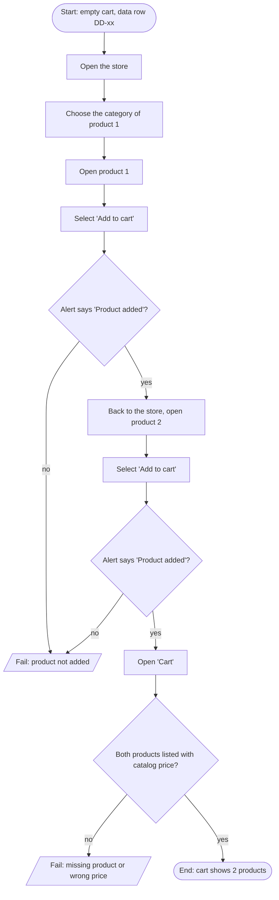

# TC-01 — Two products are added and listed with their prices

Requirements: PUR-01, PUR-02 · Plan: [qa/plans/demoblaze-purchase.md](../../plans/demoblaze-purchase.md) · Data: `src/data/demoblaze/purchase.data.json`

