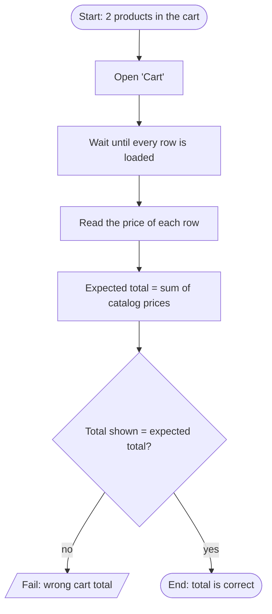

# TC-02 — Cart total equals the sum of the product prices

Requirements: PUR-02 · Plan: [qa/plans/demoblaze-purchase.md](../../plans/demoblaze-purchase.md) · Oracle: `src/data/demoblaze/catalog.json`

