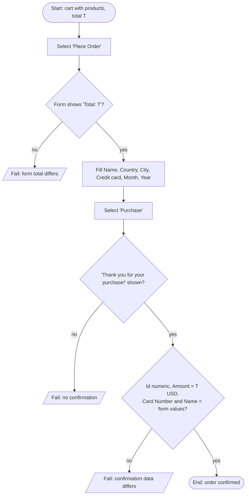

# TC-03 — Valid purchase shows a matching confirmation

Requirements: PUR-03, PUR-04 · Plan: [qa/plans/demoblaze-purchase.md](../../plans/demoblaze-purchase.md) · Data: `CustomerBuilder` + `purchase.data.json`

