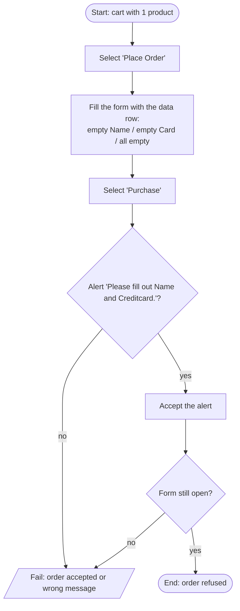

# TC-04 — Empty Name or Credit card is refused

Requirements: PUR-03 · Plan: [qa/plans/demoblaze-purchase.md](../../plans/demoblaze-purchase.md) · Data: `src/data/demoblaze/order-validation.data.json` (DD-V01..V03)

